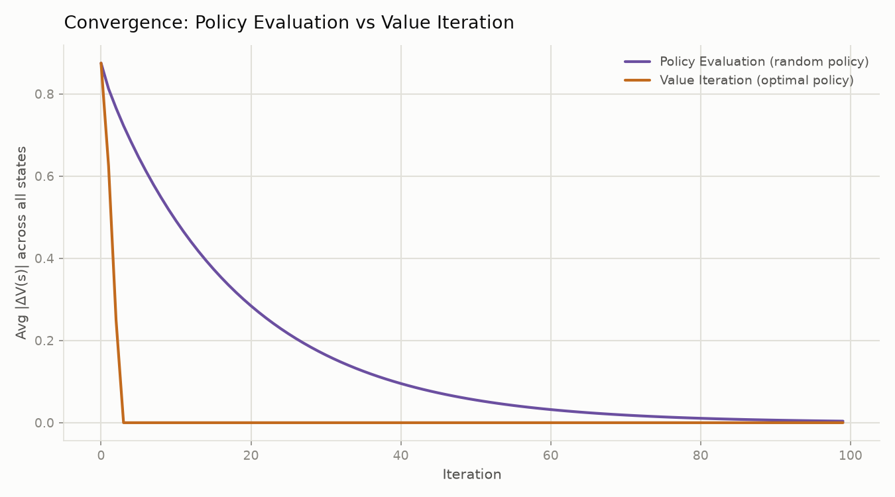
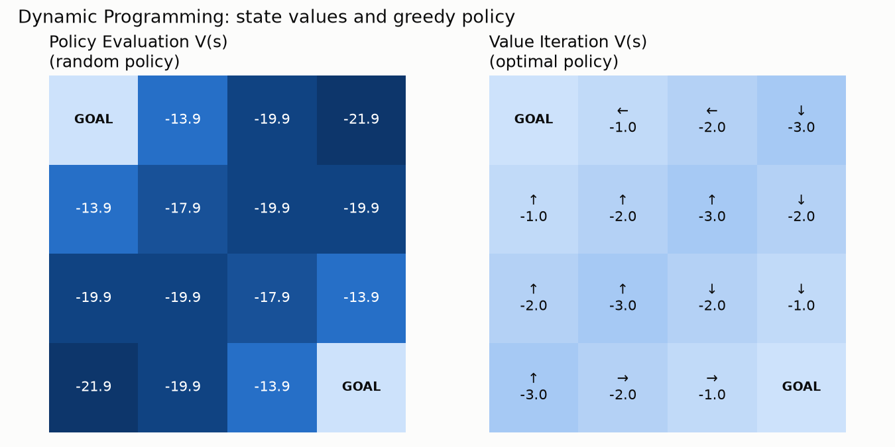
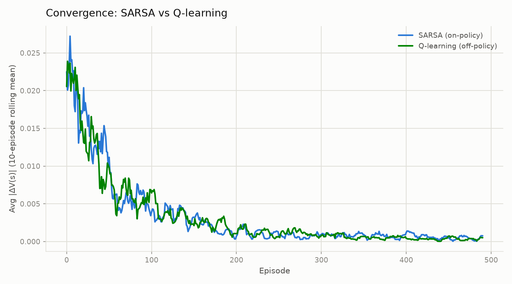
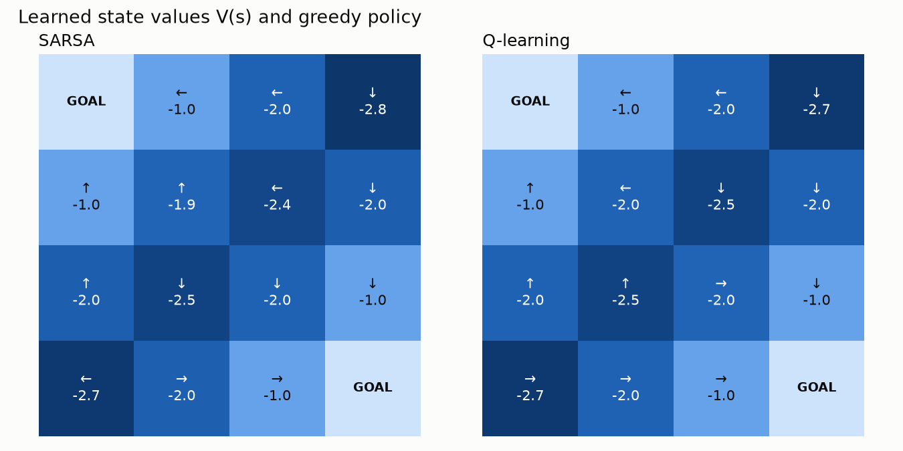
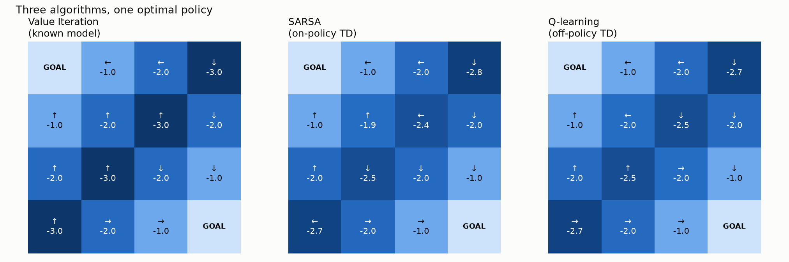

# Reinforcement Learning Exercises

More info on this project: https://www.miketerekhov.com/Pytux

Reinforcement learning implementations from a Boston University senior-year RL coursework, spanning the field's core paradigms: **dynamic programming** on a known MDP, **model-free temporal-difference control** (on- and off-policy) on that same MDP, and **tabular Double Q-learning** in a simulated driving environment.

| File | Topic | Technique |
|---|---|---|
| [`418_Code_1.py`](418_Code_1.py) | Gridworld | Iterative Policy Evaluation & Value Iteration |
| [`td_control.py`](td_control.py) | Gridworld (same MDP) | SARSA & Q-Learning (on-policy vs off-policy TD control) |
| [`compare_all.py`](compare_all.py) | Gridworld (same MDP) | Side-by-side check that DP and both TD methods land on the same policy |
| [`controller_doubleQ_working.py`](controller_doubleQ_working.py) | SuperTuxKart driving agent | Double Q-Learning with ε-greedy exploration |

All gridworld plots share one visual style, defined once in [`viz_common.py`](viz_common.py) and imported by the other scripts.

---

## 1. Gridworld — Policy Evaluation & Value Iteration

[`418_Code_1.py`](418_Code_1.py)

A classic 4×4 gridworld with two terminal (goal) states in opposite corners and a reward of `-1` for every non-terminal step. The script runs two dynamic-programming algorithms side by side over 100 iterations:

- **Iterative Policy Evaluation** — computes the value function `V(s)` for an equiprobable random policy (25% chance of each of the four moves), using the Bellman expectation equation.
- **Value Iteration** — simultaneously computes the optimal value function by taking the max over the four actions at each state (the Bellman optimality equation), and records the greedy action achieving that max.

At selected checkpoints (iterations 1, 2, 3, 10, and 100) it prints the value grid and the optimal-action grid. It also tracks `|V_k - V_k+1|` at every state across iterations for both algorithms and saves two styled plots: a convergence curve comparing Policy Evaluation vs Value Iteration, and a pair of heatmaps of the final state values with Value Iteration's greedy policy overlaid as arrows.

<p align="center">
  <br>
  
</p>

### Run it

```bash
pip install numpy matplotlib
python 418_Code_1.py
```

---

## 2. Gridworld — SARSA vs Q-Learning (Model-Free TD Control)

[`td_control.py`](td_control.py)

Same 4×4 gridworld as above, but solved without a model: instead of sweeping every state with the known transition function, the agent samples one `(state, action, reward, next_state)` transition at a time by actually acting in the environment, and learns purely from that experience. Both algorithms train for 500 ε-greedy episodes (`ε = 0.1`, `α = 0.1`, `γ = 1`):

- **SARSA** (on-policy) — bootstraps its update off the action it *actually* takes next, so it learns the value of the ε-greedy policy it's really following, exploration and all.
- **Q-learning** (off-policy) — bootstraps off the *best possible* next action regardless of what the ε-greedy policy does next, so it learns the value of the greedy policy while behaving partly randomly.

Both converge to essentially the same optimal values and policy as the Value Iteration solution above (small differences are ties broken differently) — a nice sanity check that a sampling-based, model-free method can recover what dynamic programming gets from a full model.

<p align="center">
  <br>
  
</p>

Notice the convergence curve is *noisy* even as it trends down — unlike the DP plot's smooth, monotonic decay, TD control is learning from single sampled transitions with a fixed step size, not exact full-width sweeps.

### Run it

```bash
pip install numpy matplotlib
python td_control.py
```

---

## 3. Comparing All Three — DP vs SARSA vs Q-Learning

[`compare_all.py`](compare_all.py)

The sections above each show DP and TD control converging *separately*; this script puts them in one figure to make the claim checkable at a glance. It re-runs Value Iteration (a compact, ~15-line reimplementation, since a module can't be named `418_Code_1`) alongside `td_control.py`'s SARSA and Q-learning, then reports each TD method's greedy-policy agreement with Value Iteration and plots all three value/policy grids side by side.

<p align="center">
  
</p>

### Run it

```bash
pip install numpy matplotlib
python compare_all.py
```

---

## 4. SuperTuxKart Controller — Double Q-Learning

[`controller_doubleQ_working.py`](controller_doubleQ_working.py)

A tabular **Double Q-Learning** agent that learns to steer a kart in [SuperTuxKart](https://github.com/philkr/pystk) (`pystk`) toward a target aim point on screen, trained purely through trial-and-error rollouts.

**State space** — the horizontal aim point (and its trend relative to the previous frame) is discretized into 18 named buckets, e.g. `"L4G"` (far left, gaining), `"F1G"` (near center, gaining), `"R2L"` (moderate right, losing), etc.

**Action space** — 10 discrete throttle/steer combinations, e.g. `"F100"` (full throttle, straight), `"SN10"` (hard left steer), `"SP10D"` (hard right steer with drift).

**Reward** — the distance gained along the track since the previous frame (from `kart.overall_distance`), minus a small per-frame time penalty. Going backwards, or being rescued back up the track, earns a negative reward.

**Learning algorithm** — classic Double Q-Learning: two independent Q-tables (`Qvalues_A`, `Qvalues_B`) are maintained. Each frame, the agent learns from the transition it just observed: one table is picked at random, it chooses the best action in the observed next state, and the *other* table supplies that action's value as the bootstrap target. This decorrelates action selection from action evaluation and reduces the maximization bias that plagues single-table Q-learning. Greedy actions are chosen from `Qvalues_A + Qvalues_B`.

**Exploration** — ε-greedy action selection with ε starting at `0.99` and decaying by a factor of `0.99` after every full pass over the training tracks, gradually shifting the agent from random exploration to exploiting its learned policy.

**Training loop** — `test_controller` runs 100 outer loops, rolling the kart out on each provided track, timing the run, and checkpointing both Q-tables to `QvalueA.npy` / `QvalueB.npy` after every rollout so training can be inspected or resumed. It also tracks total reward and epsilon per loop and re-saves `training_progress.png` (reward and epsilon-decay curves on twin axes, same visual style as the gridworld plots) after every loop, so training can be monitored live without a GUI.

A commented-out block at the bottom of the file preserves an earlier hand-tuned (non-learning) controller that steered directly off the arctangent of the aim point — kept for reference to show the progression from a heuristic controller to a learned one.

**Try it in the browser** — [`docs/index.html`](docs/index.html) is a JavaScript port of this agent (same 18 states, 10 actions and Double Q update) on a top-down track, with a live Q-table heatmap and sliders for ε, α and γ. Open the file locally, or serve `docs/` with GitHub Pages.

### Run it

This module is designed to be dropped into the [`pystk` course homework scaffold](https://github.com/philkr/pystk) (it imports `PyTux` from a sibling `utils.py`), so it isn't runnable standalone. Within that scaffold:

```bash
python -m controller_doubleQ_working <track_name> [<track_name> ...] [-v]
```

---

## Notes

- `418_Code_1.py` and `controller_doubleQ_working.py` originate from Colab notebooks / homework scaffolding for a Boston University reinforcement learning course, cleaned up for standalone reading here; `td_control.py` and `compare_all.py` are from-scratch extensions built to compare model-free TD control against the course's dynamic-programming solution on the same MDP.
- No external dependencies beyond `numpy` and `matplotlib` for the gridworld exercises; the kart controller additionally requires the `pystk` simulator and course-provided `utils.py`. Because `controller_doubleQ_working.py` is meant to be dropped into that separate course scaffold rather than run from this repo, its plotting helper duplicates a small slice of `viz_common.py`'s palette inline instead of importing it, so it stays self-contained wherever it's copied.
- `418_Code_1.py`, `td_control.py`, and `compare_all.py` share one plotting style, defined once in `viz_common.py`.
